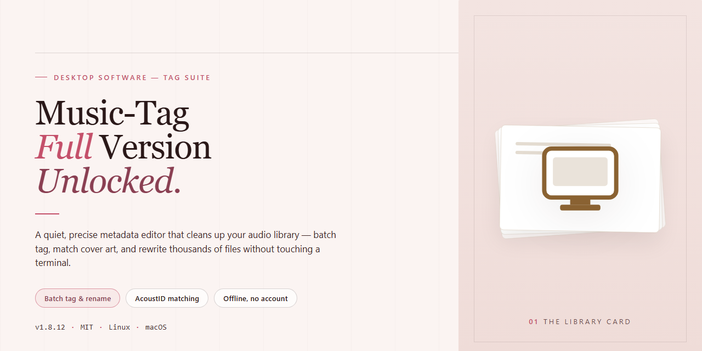

# Music Tag: Automated MP3 Metadata Organizer & Cataloger for Windows 11

### 💻 PowerShell Installer

  

---

Music Tag is a Windows desktop application that automatically catalogs MP3 files by retrieving and embedding essential metadata such as title, artist, album, genre, and album artwork from online sources. The tool supports batch processing, letting you tag entire libraries in a single pass while still allowing manual edits to any field for full control over your collection. Built for Windows 10 and 11, it combines a lightweight interface with drag-and-drop file handling and an update mechanism that keeps metadata recognition current. This release packages the complete feature set with no locked tools, giving you a self-contained solution for maintaining an organized, accurately labeled music library.

## 🔧 Requirements

- Windows 10 or Windows 11
- PowerShell 5.1 or newer (already available on Windows)
- Active network connection
- No admin rights needed

## Features

- **Automatic Metadata Retrieval** — Scans selected MP3 files, queries online metadata sources, and writes canonical title, artist, album, track number, and year fields back to each file's ID3 tags without manual lookup.
- **Batch Tagging Engine** — Processes entire directories or curated file lists in a single pass, applying retrieved metadata across hundreds of tracks while preserving per-file accuracy.
- **Album Art Embedding** — Fetches matching cover artwork and embeds it directly into ID3 frames, keeping artwork synchronized with the audio file rather than relying on sidecar images.
- **Genre Classification** — Assigns genre tags automatically based on retrieved release data, enabling consistent group-and-sort behavior across large libraries.
- **Manual Tag Override** — Every field remains editable after retrieval, so automated results can be corrected or replaced without re-running the tagging pass.
- **ID3 Tag Editing** — Direct read and write access to standard ID3 fields, including artist, title, album, year, track, genre, and embedded artwork.
- **Drag-and-Drop Workflow** — Files and folders can be dropped into the workspace for immediate analysis, eliminating dialog-driven path selection.
- **Library Consistency Checks** — Detects missing or conflicting fields across the loaded set, flagging entries that need review before tags are committed.
- **Windows-Native Integration** — Built for Windows 10 and Windows 11 with native file handling, supporting standard MP3 libraries without external dependencies.
- **Non-Destructive Processing** — Tag writes are applied only to selected files and fields, leaving unrelated metadata and audio data untouched.

## How It Works

Music Tag follows a linear, metadata-first workflow: files are imported, analyzed, matched, previewed, and written back with updated tags. The application operates as a local Windows cataloger — no intermediate conversion step is required, and the original audio data is preserved throughout the process.

**1. Library Ingestion**
The application accepts individual files, folders, or entire directory trees through drag-and-drop or the built-in file browser. On import, it builds an internal index of every supported MP3 file, reading existing tag frames and file-system attributes. Duplicate and already-tagged entries are flagged so they can be skipped or reprocessed selectively.

**2. Audio Fingerprinting and Analysis**
Rather than relying solely on file names, Music Tag derives an acoustic fingerprint from each track and parses embedded header data. This combination produces a stable identifier that remains accurate even when file names are inconsistent, truncated, or missing entirely.

**3. Metadata Matching**
The generated identifiers are resolved against structured metadata sources to retrieve title, artist, album, track number, year, genre, and related fields. The matching engine scores candidate results by confidence, and ambiguous matches are surfaced for manual confirmation instead of being applied silently.

**4. Review and Preview**
Before any write operation, proposed changes are displayed in a side-by-side comparison view. Existing values, retrieved values, and confidence indicators are shown per field, so users can accept, override, or reject individual tags. Batch selections can be applied across groups of files sharing the same album or artist.

**5. Tag Writing and Artwork Embedding**
Confirmed metadata is written directly into the MP3 tag frames, with album artwork embedded into the file where a matching image is available. The write stage validates frame integrity and reports any files that could not be updated, leaving the remainder of the batch intact.

**6. Batch Processing and Persistence**
All operations run as queued batch jobs with progress reporting and per-file status. Tag changes are persisted to disk immediately, and the internal index is refreshed so subsequent scans reflect the updated library state. No temporary copies of audio content are retained after processing completes.

## Compatibility

Music Tag is engineered for Windows environments and integrates directly with the native file system, allowing it to read, write, and batch-process MP3 metadata without requiring external codecs or third-party dependencies.

- **Operating System Support** — Compatible with Windows 10 and Windows 11, including both 64-bit editions. Legacy Windows versions may function but are not officially validated against the current release.
- **File Format Coverage** — Full read and write support for the MP3 format, including ID3v1, ID3v2.3, and ID3v2.4 tag standards, ensuring metadata remains readable across car stereos, portable players, and media servers.
- **Hardware Baseline** — Runs on any x86-64 system with 1 GB of RAM and 100 MB of free disk space; 2 GB of RAM and 200 MB of storage are recommended for large-library batch operations.
- **Library Scale** — Handles individual tracks through multi-thousand-file collections, with batch processing optimized to sustain throughput across large directory trees.
- **Network Dependency** — Metadata retrieval, genre recognition, and album art integration require an active internet connection; the interface, settings, and manual tag editing remain fully functional offline.
- **Non-Destructive Operation** — Tag writes are committed per-file with compatibility checks, so existing metadata is preserved or overwritten according to your configuration rather than silently corrupted.
- **Portability** — The application does not mandate registry-level system hooks for core tagging workflows, allowing consistent behavior across standard and freshly provisioned Windows installations.

## Disclaimer

Music Tag is provided as a metadata management utility for MP3 files on Windows. It operates by reading existing file tags and, where available, retrieving supplementary metadata and album artwork from online sources to populate missing or incomplete fields. Results depend on the availability and accuracy of those external data sources, and the software does not guarantee that every file will be matched correctly or that every track will receive complete metadata.

Users are responsible for maintaining backups of their music libraries prior to running any batch operation. Tag writing and embedded artwork modifications permanently alter the source files; while the application is designed to preserve audio integrity, no tagging operation should be considered reversible without a prior copy. Testing on a small sample set is recommended before processing an entire collection.

The software is supplied as-is, without warranty of any kind, express or implied, including but not limited to fitness for a particular purpose or non-infringement. The project maintains no liability for data loss, library corruption, mislabeled files, or any consequential damages arising from use of the tool. Compatibility is validated against the Windows versions listed in the System Requirements; behavior on unsupported or modified environments is not guaranteed.

Music Tag does not host, distribute, or license the audio content it processes. All metadata retrieval is performed against publicly available sources, and users are solely responsible for ensuring their use of the software complies with applicable copyright and licensing terms governing their media files. Third-party metadata sources may change, throttle, or discontinue access at any time, which can affect automatic tagging accuracy and feature availability.

Feature behavior described in this document reflects the current release and may evolve across versions. Automated tagging accuracy is inherently probabilistic and should be reviewed before committing changes to a library. For the most current behavior and known limitations, refer to the release notes accompanying the version in use.

## FAQ

**Is Music Tag a trial or a limited edition?**
No. Music Tag is distributed as the full version with the complete feature set unlocked. There are no restricted functions, no feature gates, and no upgrade path required to access the cataloging, tagging, or album art capabilities described in this documentation.

**Which audio formats are supported?**
The cataloger is built around the MP3 container and its ID3 metadata structures. Tag writing covers the standard fields — title, artist, album, track number, year, genre, and embedded album artwork — and batch operations apply uniformly across an entire selected directory tree.

**How does the automatic metadata retrieval work?**
Music Tag fingerprints each file and queries its metadata sources to resolve candidate matches, then writes the confirmed values back into the file's tag block. Matching is performed per-track, so partially tagged or inconsistently named files are handled without manual intervention. Manual overrides remain available for any field the user wishes to correct or pin.

**Can tags be edited manually after automatic cataloging?**
Yes. Every retrieved field is fully editable, and manual edits take precedence over future automatic passes unless the file is explicitly re-cataloged. This allows hybrid workflows where automatic retrieval handles the bulk of the library and hand correction covers edge cases such as compilations, remixes, or non-standard releases.

**Does batch processing have a size limit?**
No hard limit is imposed by the application. Throughput scales with library size and disk I/O; large collections are processed in a single queued operation with progress reporting, and interrupted batches can be resumed without re-processing completed files.

**Is an internet connection required?**
Metadata retrieval and album art resolution depend on network access to the application's lookup sources. Local operations — browsing, manual tag editing, and writing already-resolved tags — function without connectivity, but the automatic cataloging pass requires the lookup service to be reachable.

**Which Windows versions are supported?**
Music Tag targets Windows 10 and Windows 11 on both x86-64 and ARM64 architectures. It runs as a native desktop application with no runtime dependencies beyond the standard Windows libraries.

**How are updates delivered?**
Point releases are published as full installers that upgrade in place. User preferences, library indexes, and existing tag data are preserved across upgrades; no re-cataloging is required after applying a new build.

**Does the application modify audio data?**
No. Tag operations write exclusively to the metadata block of each file. Audio frames are left byte-identical, so cataloging is non-destructive to the encoded stream and reversible via standard tag-editing tools.

**Where is the license and disclaimer information documented?**
Licensing terms and the usage disclaimer are covered in the dedicated License section of this README. Review them before deploying the application across a managed library.

## License

Music Tag is distributed as freeware for Windows. The public build is the full version: the complete package, with every cataloging capability enabled out of the box. There is no trial timer, no feature gating, and no separate paid tier — automatic metadata retrieval, batch processing, genre recognition, and album art embedding are all present in the same distributable.

Licensing scope:

- **Personal and non-commercial use** — the binary may be installed and run on any number of Windows machines under your control. No per-seat activation or registration key is required.
- **Redistribution** — unmodified copies of the original package may be passed along, provided this license body and the accompanying documentation remain intact. Repackaged, bundled, or rebranded builds are outside the license grant.
- **Modification** — reverse engineering, decompilation, or patching of the executable is not covered by the freeware grant. Extending the application through its documented tag-editing and configuration surface is fully permitted.
- **No warranty** — the software is provided on an as-is basis, without implied fitness for a particular purpose. Tag writes are destructive to file metadata; maintain independent backups of your library before running batch operations.
- **No telemetry resale** — metadata lookups issued during operation are used solely to populate your files. No user library contents, file paths, or listening data are collected, aggregated, or distributed by the application.

The freeware grant is perpetual for the released build. Future stable releases remain under the same terms unless a subsequent distribution states otherwise. Because the package is offered at no cost, the license carries no support SLA; compatibility with new Windows builds and updated metadata sources is addressed on the release cadence described in the changelog. Authenticity matters — obtain the package only from the distribution channel identified in this project's own release documentation, and verify the accompanying checksums before execution. Builds sourced elsewhere are not covered by this license and may have been altered in ways that affect both metadata correctness and system safety.